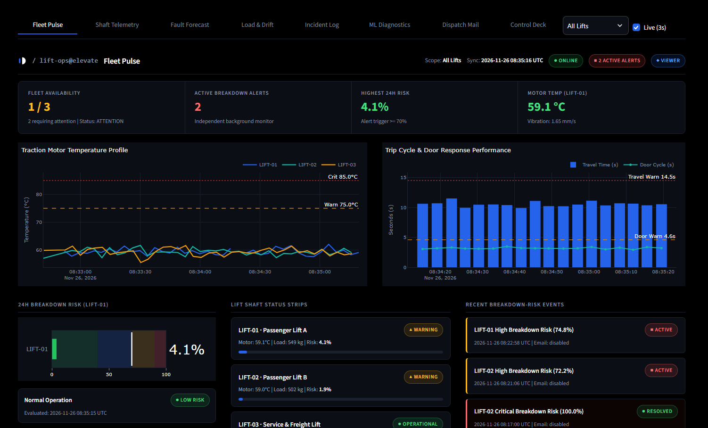
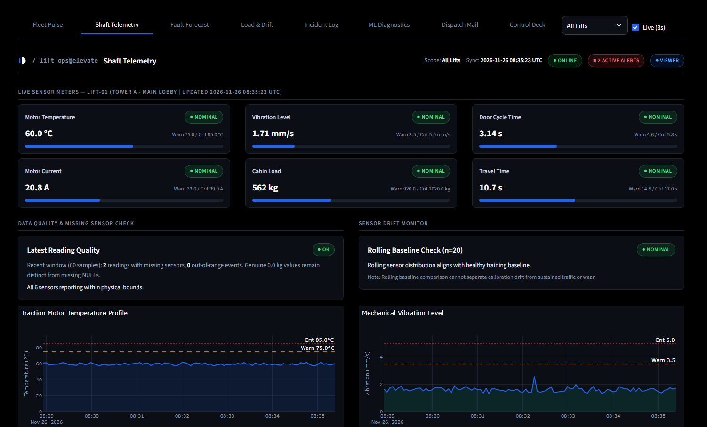
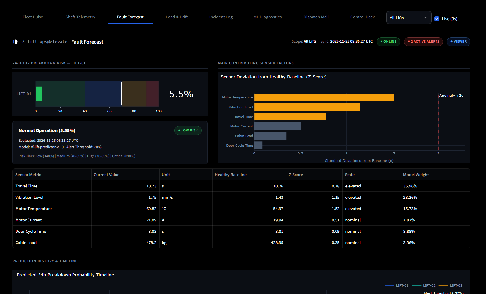
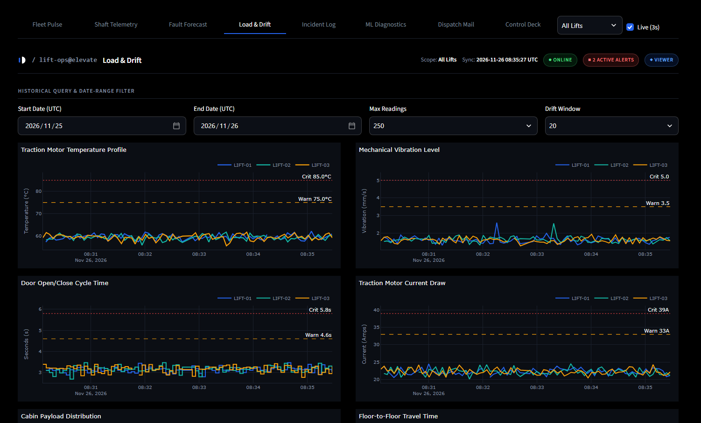
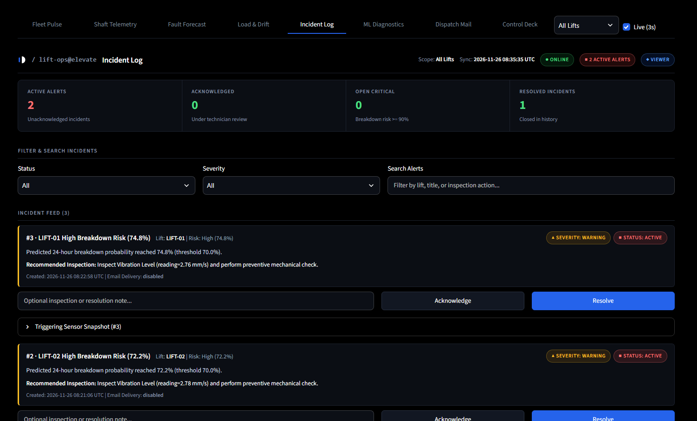
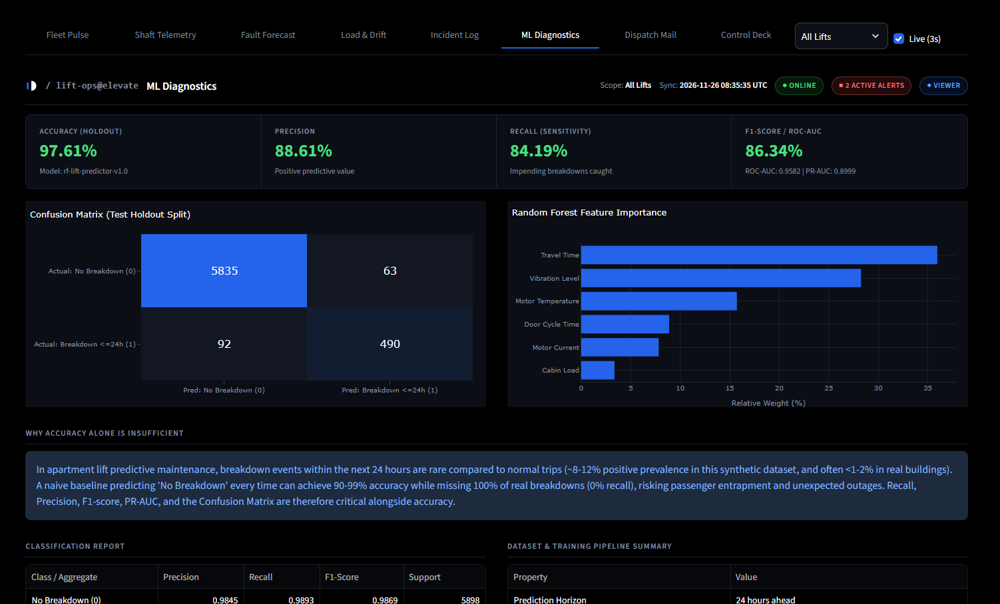
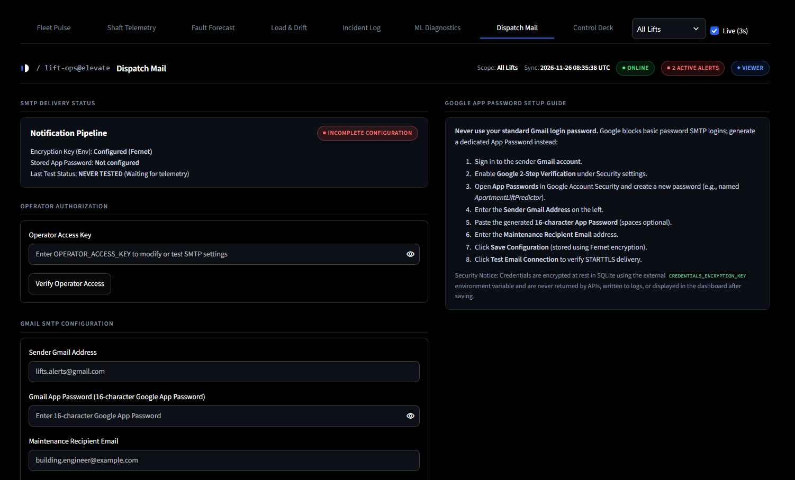
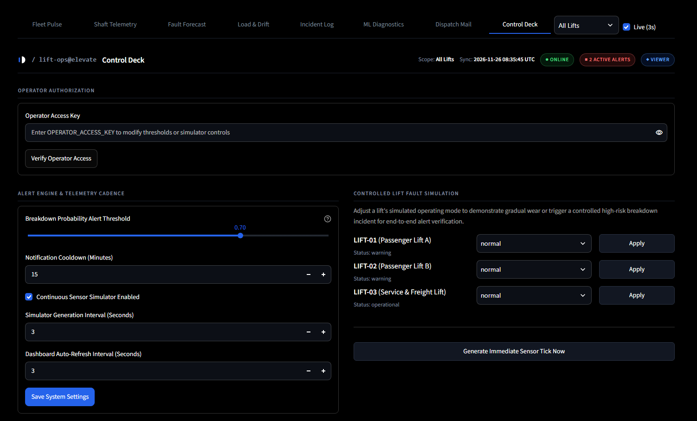
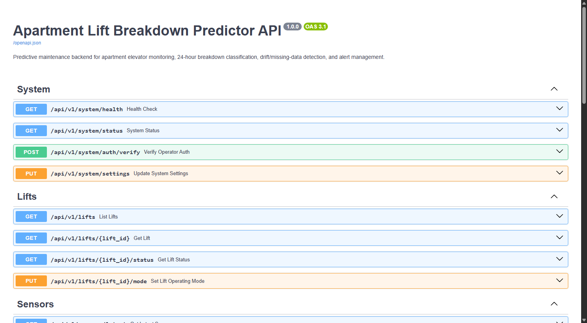

# Apartment Lift Breakdown Predictor — Technical Project Report

## 1. Executive Summary

The **Apartment Lift Breakdown Predictor** is an end-to-end predictive maintenance platform for residential apartment elevators (`LIFT-01`, `LIFT-02`, `LIFT-03`). Instead of waiting for a hard fault or passenger entrapment, the system continuously tracks six correlated electromechanical sensor streams and forecasts the probability of a lift breakdown within the next **24 hours** using a trained Random Forest Classifier.

When breakdown risk reaches the configurable threshold (default **70%**), an independent background alert engine in FastAPI records a deduplicated incident in SQLite and dispatches a **Gmail SMTP (STARTTLS)** maintenance notification with specific technician inspection guidance.

---

## 2. System Architecture & Services

The system runs as three containerized services coordinated via Docker Compose with a shared SQLite WAL volume (`sqlite_data`):

1. **Lift Sensor Simulator (`simulator`)**: Streams realistic, timestamped sensor telemetry (`motor_temp`, `vibration_level`, `door_cycle_time`, `motor_current`, `cabin_load`, `travel_time`) across residential rush-hour traffic, normal operation, and controlled fault states.
2. **FastAPI Backend & Independent Alert Engine (`backend`)**: Validates data quality, monitors rolling sensor drift, runs Joblib ML inference, evaluates deduplicated alert rules/cooldowns independently of browser sessions, and exposes OpenAPI/Swagger endpoints (`/docs`).
3. **Pure-Black OLED Telemetry Dashboard (`dashboard`)**: Built with Streamlit and custom CSS (`#000000` canvas, `#0B0E14` obsidian panels, `#2563EB` cobalt accents, spaced borderless top navigation), featuring 3-second `@st.fragment` auto-refresh, threshold meters, bullet/Z-score visualizations, alert management, and encrypted Gmail SMTP setup.

---

## 3. Machine Learning Pipeline & Evaluation

### Synthetic Historical Dataset (`ml/generate_dataset.py`)
- **Dataset Size**: `25,920` rows at 15-minute intervals over 90 days across 3 lifts.
- **Physical Relationships**: Models morning/evening rush-hour traffic peaks, non-failing heavy-load bursts, and three degradation modes (`traction_bearing_wear`, `door_operator_fault`, `motor_winding_overload`).
- **24-Hour Lookahead Labeling**: `breakdown_within_24h = 1` if a simulated breakdown occurs in `(t, t + 24h]`, preventing label leakage from instantaneous feature thresholds.
- **Missing Values**: Injects ~2.5% missing readings (`3,923` missing values total) handled inside the Scikit-learn `Pipeline` via `SimpleImputer(strategy="median")`.

### Holdout Evaluation Results (`ml/models/model_evaluation.json`)
Evaluated on a **chronological 75% / 25% split** (`19,440` training / `6,480` test rows) to prevent temporal leakage:

| Metric | Observed Score | Notes |
|---|---|---|
| **Positive Class Prevalence** | `8.98%` | Breakdowns are uncommon compared to normal trips |
| **Accuracy** | `97.61%` (`0.9761`) | Overall holdout accuracy |
| **Precision** | `88.61%` (`0.8861`) | High confidence on predicted breakdowns |
| **Recall (Sensitivity)** | `84.19%` (`0.8419`) | Impending 24h breakdowns caught early |
| **F1-Score** | `86.34%` (`0.8634`) | Precision/recall harmonic mean |
| **ROC-AUC / PR-AUC** | `0.9582` / `0.8999` | Strong ranking across thresholds |
| **Confusion Matrix (`n = 6,480`)** | `TN=5835`, `FP=63`, `FN=92`, `TP=490` | Calculated directly from test predictions |

*Why accuracy alone is insufficient:* With breakdown intervals making up under 9% of samples here (and often under 2% in real buildings), predicting "No Breakdown" for every trip yields ~91% accuracy while catching 0% of real failures. Recall, Precision, F1-score, PR-AUC, and the Confusion Matrix ensure failures are caught without alert fatigue.

---

## 4. Dashboard & API Screenshots

### 4.1 Fleet Pulse (Overview)
Executive 4-slot availability & risk strip, traction motor temperature profile, grouped trip cycle & door response chart, horizontal bullet breakdown risk indicator, lift shaft status strips, and recent breakdown-risk timeline.

### 4.2 Shaft Telemetry (Live Lift Monitoring)
Six horizontal threshold meters (`Motor Temperature`, `Vibration Level`, `Door Cycle Time`, `Motor Current`, `Cabin Load`, `Travel Time`), missing-data vs. genuine-zero (`0.0 kg` empty cabin) quality validation, rolling baseline drift monitor, and 6-sensor time-series grid.

### 4.3 Fault Forecast (Breakdown Prediction)
Horizontal bullet breakdown risk indicator with configurable alert threshold needle, Z-score deviation chart showing which sensors deviate from the healthy baseline, contributing factor table, and probability timeline.

### 4.4 Load & Drift (Sensor Analytics)
Date-range filtered historical charts across all six lift sensors, rolling baseline drift table (`Z-Shift` and tail exceedance rates) with documented methodology limitations, and raw historical readings log.

### 4.5 Incident Log (Alert Center)
Deduplicated incident timeline with severity and status filters, text search, color + geometric symbol pills, technician inspection recommendations, email delivery status, triggering sensor snapshots, and Acknowledge / Resolve workflows.

### 4.6 ML Diagnostics (Model Performance)
Real Scikit-learn holdout metrics, Confusion Matrix heatmap, Random Forest feature importance ranking, per-class classification report, dataset summary, and imbalance explanation.

### 4.7 Dispatch Mail (Email Notification Settings)
Operator-protected Gmail SMTP configuration using Google App Passwords encrypted at rest with `Fernet` (`CREDENTIALS_ENCRYPTION_KEY` from `.env`), masked credential state, STARTTLS configuration, enable/disable toggle, and live test email verification.

### 4.8 Control Deck (System Settings)
Operator-protected runtime controls for alert threshold, cooldown window, simulator cadence, dashboard refresh interval, and per-lift fault simulation modes (`normal`, `degrading`, `critical`).

### 4.9 FastAPI Swagger Documentation (`/docs`)
Interactive REST API specification covering system health/auth, lifts, sensor ingestion/drift/quality, predictions/model metrics, alerts, and safe email configuration.

---

## 5. Security & Verification Summary

- **Credential Protection**: Gmail App Passwords are encrypted with `cryptography.fernet.Fernet` in SQLite; `CREDENTIALS_ENCRYPTION_KEY` is read exclusively from environment variables. Passwords are masked in the UI and redacted from API responses, HTTP 422 validation errors (`SecretStr` + custom `RequestValidationError` handler), and logs.
- **Operator Access Control**: Configuration mutations (`PUT /api/v1/email/config`, `PATCH /api/v1/email/toggle`, `POST /api/v1/email/test`, `PUT /api/v1/system/settings`, `PUT /api/v1/lifts/{id}/mode`) verify `X-Operator-Key` using constant-time `hmac.compare_digest`.
- **Automated Tests (`python -m pytest -v`)**: **13/13 tests passing** across ML, data quality/drift, alert deduplication/cooldown, SMTP failure handling, API security, and end-to-end restart persistence.
- **Docker & Browser Verification**: Verified multi-container startup via `docker compose up -d --build`, live ingestion across 3 lifts, controlled critical alert creation/resolution, SQLite persistence across `docker compose restart`, and zero console errors across all 8 views in headless Chrome.
